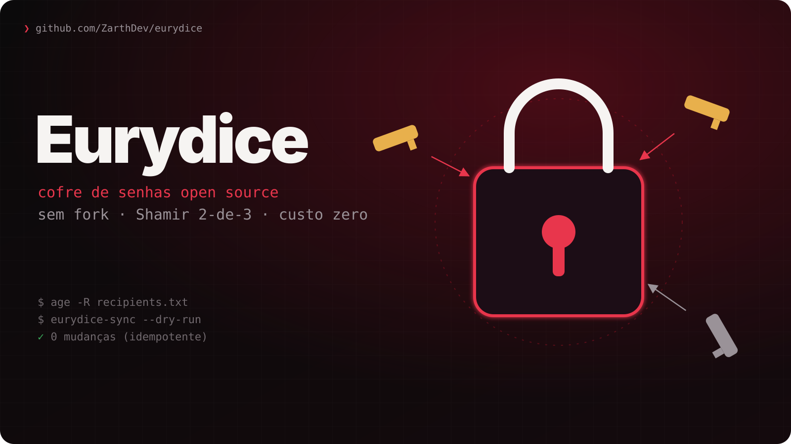
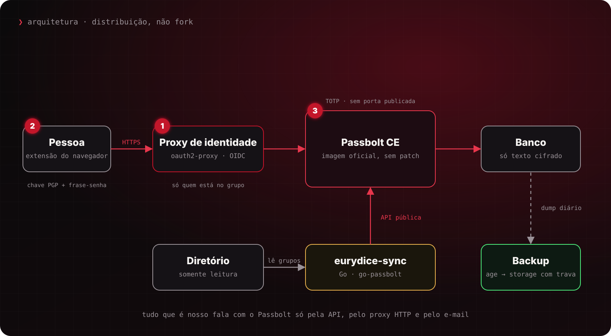
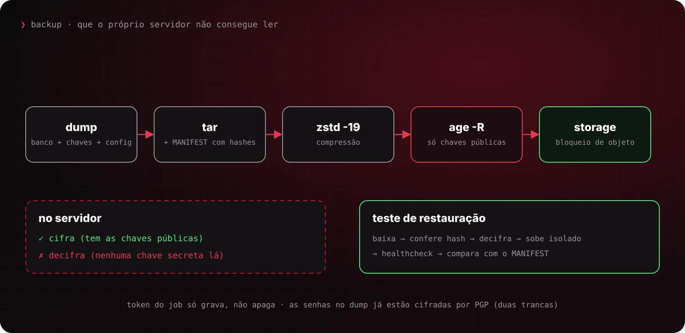
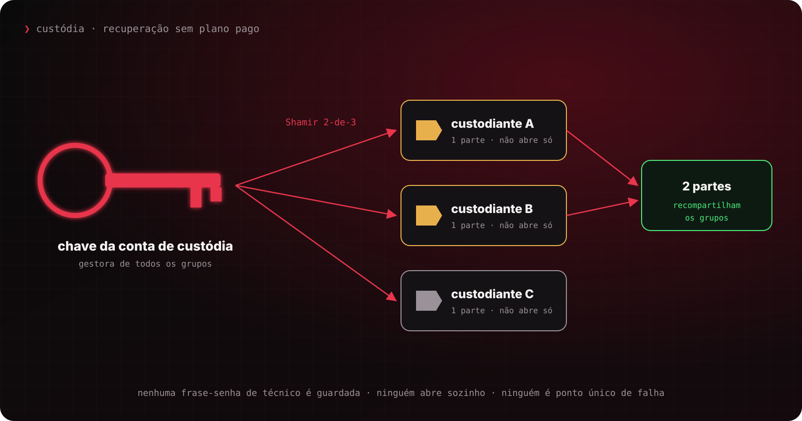

<div align="center">



# Eurydice

**Um cofre de senhas para times de TI, montado em volta do Passbolt CE, sem alterar uma linha dele.**

SSO na borda · sync de diretório em Go · backup que o servidor não consegue ler · recuperação por custódia Shamir 2-de-3

[](https://github.com/ZarthDev/eurydice/actions/workflows/ci.yml)


[Por quê](#por-quê) · [Arquitetura](#arquitetura) · [Tutorial](#tutorial) · [Operação](#operação) · [Segurança](#modelo-de-segurança) · [FAQ](#faq)

</div>

> **English summary:** Eurydice is a set of small, auditable add-ons around the **official, unmodified Passbolt CE**: an OIDC gate in front of the server (oauth2-proxy), a Go directory sync that plays the role of SCIM, a nightly backup encrypted with `age` that the server itself cannot decrypt, and a Shamir 2-of-3 custody ceremony for account recovery. No fork, no custom crypto, zero license cost. Docs below are in Portuguese.

---

## Por quê

Todo time de infraestrutura acumula senhas: switches, consoles de nuvem, contas de serviço, painéis de fornecedor. O padrão comum é um arquivo de cofre local com **uma** senha-mestra, e aí o problema vira o *bus factor*.

O Eurydice nasceu de dois requisitos:

1. **custo zero**;
2. **servidor auditado**: um cofre de senhas não pode depender de "confia que está certo".

O [Passbolt CE](https://github.com/passbolt/passbolt_api) cumpre o segundo (servidor e extensão auditados, OpenPGP de ponta a ponta, AGPL). As funções que ficam no plano pago — **SSO, sincronização de diretório e recuperação de conta** — o Eurydice entrega **em volta** do servidor, só por interfaces públicas.

### A regra de ouro: distribuição, não fork

- O Passbolt roda pela **imagem oficial**, sem patch.
- Tudo que é nosso fala com ele só pela **API REST**, por **HTTP na borda** e pelo **e-mail**.
- Atualizar o cofre continua sendo trocar a versão da imagem.

> Fazer fork para ter SSO significaria escrever criptografia própria (o SSO desse tipo de cofre libera a frase-senha da chave no navegador), manter extensão e apps próprios e fazer merge a cada release de segurança. Não vale.

## Arquitetura



Para chegar a uma senha, a pessoa passa por **três portas independentes**:

| # | Porta | Peça | O que garante |
|---|---|---|---|
| 1 | Identidade corporativa | `oauth2-proxy` (OIDC) | só quem está na lista chega ao servidor; suspendeu no IdP, perdeu o acesso |
| 2 | Chave PGP + frase-senha | extensão oficial do Passbolt | *zero-knowledge*: o servidor só guarda texto cifrado |
| 3 | TOTP | Passbolt CE | segundo fator no login |

O Passbolt **não publica porta**: só a borda e o sync o enxergam, numa rede interna do compose.

### O que tem no repositório

```
deploy/   compose.yaml (Passbolt CE + MariaDB + oauth2-proxy + sync), .env.example, lista de e-mails
sync/     eurydice-sync em Go: o "SCIM" da CE (dry-run por padrão, com travas)
backup/   backup diário cifrado com age + teste de restauração + units do systemd
custody/  cerimônia Shamir 2-de-3 com age + ssss (sem criptografia caseira)
docs/     diagramas
```

## Tutorial

### 0. Pré-requisitos

- Um servidor Linux com **Docker** e o plugin **compose** (uma VM ou container pequeno basta);
- um **domínio** e um terminador **TLS** na frente da borda (Caddy, nginx, Traefik, Cloudflare Tunnel…);
- um **provedor de identidade OIDC** (Google Workspace, Microsoft Entra ID, Keycloak, Authentik…);
- um **SMTP** para os convites;
- nas máquinas dos custodiantes: [`age`](https://github.com/FiloSottile/age) e [`ssss`](http://point-at-infinity.org/ssss/).

```bash
git clone https://github.com/ZarthDev/eurydice.git /opt/eurydice
cd /opt/eurydice/deploy
cp .env.example .env
cp edge/emails.example.txt edge/emails.txt
```

### 1. Configure o `.env`

```bash
# segredos que você precisa gerar
openssl rand -base64 24                       # -> DB_PASSWORD
openssl rand -base64 32 | tr -- '+/' '-_'     # -> COOKIE_SECRET
```

Preencha `PUBLIC_URL`, o SMTP e o OIDC. Fixe `PASSBOLT_TAG` numa versão `-ce` específica.

### 2. Crie o cliente OIDC no seu provedor

| Campo | Valor |
|---|---|
| Tipo | aplicação web (OIDC) |
| Redirect URI | `https://SEU-DOMINIO/oauth2/callback` |
| Escopos | `openid email profile` |

Copie *issuer*, *client id* e *client secret* para o `.env`.

> No Google: *APIs e serviços → Credenciais → ID do cliente OAuth* (tipo **interno**, se for Workspace), issuer `https://accounts.google.com`.

### 3. Liste quem pode entrar

`deploy/edge/emails.txt` é a **fonte única**: a borda só deixa entrar quem está nele e o sync cria e suspende contas a partir dele.

```text
ana@exemplo.com.br
bruno@exemplo.com.br
```

### 4. Suba

```bash
docker compose up -d
docker compose ps
```

Aponte seu terminador TLS para a porta da borda (`EDGE_BIND`, padrão `127.0.0.1:4180`) e confira o healthcheck:

```bash
docker compose exec passbolt su -s /bin/bash -c \
  "/usr/share/php/passbolt/bin/cake passbolt healthcheck" www-data
```

### 5. Primeiro administrador

```bash
docker compose exec passbolt su -s /bin/bash -c \
  "/usr/share/php/passbolt/bin/cake passbolt register_user \
   -u voce@exemplo.com.br -f Seu -l Nome -r admin" www-data
```

Abra o link recebido por e-mail, instale a **extensão oficial do Passbolt** e crie sua chave. Depois, em *Administração*, ative o **TOTP**.

### 6. Conta do bot e da custódia

Crie mais duas contas pelo mesmo comando:

| Conta | Papel | Para quê |
|---|---|---|
| `eurydice-sync@…` | **admin**, sem ser gestor de nenhum grupo | administra contas; **não consegue ler senhas** |
| `custodia@…` | usuário, **gestor de todos os grupos** | recuperação: guarda acesso a tudo, protegida por Shamir |

Para o bot, exporte a chave privada e a frase-senha para `deploy/secrets/` (fora do git) e copie o certificado interno do Passbolt, que o sync vai **fixar**:

```bash
mkdir -p secrets && chmod 700 secrets
# bot.key  = chave privada PGP (armored) da conta do bot
# bot.pass = frase-senha dessa chave
docker compose exec passbolt cat /etc/ssl/certs/certificate.crt > secrets/passbolt.crt
chmod 600 secrets/*
```

### 7. Sync: primeiro em dry-run

```bash
docker compose --profile sync run --rm sync
```

Cada linha é um evento JSON:

```json
{"event":"planned","action":"create","email":"bruno@exemplo.com.br","apply":false}
{"event":"summary","mode":"dry-run","changes":1,"notices":0}
```

Conferiu? Ligue `SYNC_APPLY=true` no `.env` e agende:

```bash
sudo cp ../sync/eurydice-sync.{service,timer} /etc/systemd/system/
sudo systemctl enable --now eurydice-sync.timer
```

**Travas do sync:**

- lista vazia é **recusada** (protege contra arquivo truncado ou fonte fora do ar);
- no máximo `SYNC_MAX_CHANGES` mudanças por execução (padrão 3);
- contas em `SYNC_PROTECTED` e a do próprio bot **nunca** são suspensas;
- TLS fixado: com `EURYDICE_CA_FILE`, só aquele certificado é aceito;
- container *distroless*, `read_only`, `cap_drop: ALL`, `no-new-privileges`;
- idempotente: rodar duas vezes seguidas dá zero mudanças.

> Quer outra fonte além do arquivo? Use `EURYDICE_SOURCE_CMD` com qualquer comando que imprima um e-mail por linha (um script que lê um grupo do seu IdP, por exemplo).

### 8. Backup



Em cada máquina de custodiante:

```bash
age-keygen -o ~/.config/eurydice/custodiante.agekey   # guarde também uma cópia offline
```

No servidor, junte **só as chaves públicas** (`age1…`):

```bash
cp backup/recipients.example.txt backup/recipients.txt   # e edite
sudo cp backup/eurydice-backup.{service,timer} /etc/systemd/system/
sudo systemctl enable --now eurydice-backup.timer
```

Cópia fora da máquina (opcional, recomendada): configure um remote no `rclone` para um storage com **bloqueio de objeto** e um token que **grava mas não apaga**, e defina `RCLONE_REMOTE` na unit.

**Teste a restauração** na máquina de um custodiante. Só conta como backup o que passou aqui:

```bash
./backup/restore-test.sh eurydice-20260101T023000Z.tar.zst.age ~/.config/eurydice/custodiante.agekey
# ... usuários: 12/12 · recursos: 340/340
# RESTAURAÇÃO OK
```

### 9. Cerimônia da custódia (Shamir 2-de-3)



Com os 3 custodiantes juntos, numa máquina confiável:

```bash
./custody/split.sh custodia-privada.asc custodia-frase.txt
```

- `custody/out/custodia-material.tar.age` pode ficar junto do backup: **sozinho não abre nada**;
- `custody/out/partes.txt` tem 3 linhas: **uma para cada custodiante**. Depois apague o arquivo.

Antes de apagar qualquer coisa, prove que funciona com duas partes:

```bash
./custody/combine.sh custody/out/custodia-material.tar.age /tmp/teste-custodia
```

## Operação

### Alguém esqueceu a frase-senha ou trocou de computador

Num cofre *zero-knowledge* ninguém abre a chave de outra pessoa. A recuperação é por política:

1. **Senha de trabalho sempre em grupo**, nunca só no espaço pessoal (é isso que torna a recuperação possível);
2. o admin **reconvida** a pessoa, que cria uma chave nova em ~2 minutos;
3. os gestores dos grupos (ou **dois** custodiantes, via `combine.sh`) recompartilham os acessos.

> **"Não dá pra recuperar com o QR code do autenticador?"** Não. O TOTP prova *quem você é*, mas não carrega a chave que *decifra* as senhas.

### Alguém saiu do time

Tire o e-mail de `edge/emails.txt`. A borda bloqueia na hora; o sync suspende a conta na próxima execução. **Depois, troque as senhas que a pessoa conhecia**: o Passbolt guarda, não rotaciona.

### Atualizar o Passbolt

1. Leia o changelog da nova versão;
2. rode um backup e o teste de restauração;
3. troque `PASSBOLT_TAG` e `docker compose up -d`;
4. rode o healthcheck.

## Modelo de segurança

| Ameaça | Mitigação |
|---|---|
| Servidor invadido | só texto cifrado por PGP; sem chaves secretas de backup ou custódia no servidor |
| Servidor invadido tenta apagar o histórico | storage com bloqueio de objeto + token sem permissão de apagar |
| Ex-colaborador | bloqueio na borda (lista/IdP) + suspensão pelo sync |
| Fonte da lista quebra e volta vazia | sync recusa lista vazia e limita mudanças por execução |
| Bot comprometido | o bot é admin mas **não é gestor de grupo**: não lê senhas |
| Custodiante sozinho mal-intencionado | Shamir 2-de-3: uma parte não abre nada |
| Perda do servidor | backup cifrado fora da máquina + teste de restauração |

**O que o Eurydice não faz:** rotação automática de senhas de sistemas (use um cofre de segredos para isso), e não substitui a política de MFA do seu IdP.

### Hardening já ligado no compose

- `PASSBOLT_REGISTRATION_PUBLIC=false`: ninguém se cadastra sozinho;
- `PASSBOLT_SECURITY_SMTP_SETTINGS_ENDPOINTS_DISABLED=true`: o SMTP não muda pela tela;
- `PASSBOLT_SECURITY_PREVENT_EMAIL_ENUMERATION=true`: a API não confirma se um e-mail existe.

> **Atenção:** na CE, **nomes de pasta e tags não são cifrados**. Nunca coloque segredo em nome de pasta.

## FAQ

**Por que não Vaultwarden?** É ótimo, mas o *servidor* é uma reimplementação comunitária sem auditoria independente. Para um cofre corporativo, preferimos servidor auditado.

**Isso vira Passbolt Pro depois?** Sim. A CE vira Pro com a chave de licença, sem migrar dados. As peças do Eurydice continuam funcionando, porque usam só a API pública.

**Dá para usar sem OIDC?** Dá (remova o serviço `edge` e publique o Passbolt atrás do seu proxy), mas você perde o corte de acesso imediato e a fonte única de pessoas.

**Por que `ssss` e `age` em vez de uma lib de Shamir em Go?** Para não escrever criptografia: as duas ferramentas são conhecidas, pequenas e auditáveis.

## Contribuindo

Issues e PRs são bem-vindos. Antes de abrir um PR:

```bash
cd sync && go vet ./... && go test ./...
shellcheck -S warning backup/*.sh custody/*.sh
```

A regra de ouro vale para contribuições também: **nada que exija alterar o código do Passbolt**.

## Licença

[MIT](LICENSE) © Arthur Martins. O Eurydice **não é afiliado** à Passbolt SA; "Passbolt" é marca da respectiva titular. O Passbolt CE é distribuído pelos seus autores sob a AGPL-3.0 e é usado aqui sem modificação.

O nome vem do mito de Orfeu e **Eurídice**: trazer as coisas de volta sem nunca olhar o que não deve ser visto. 🔐
